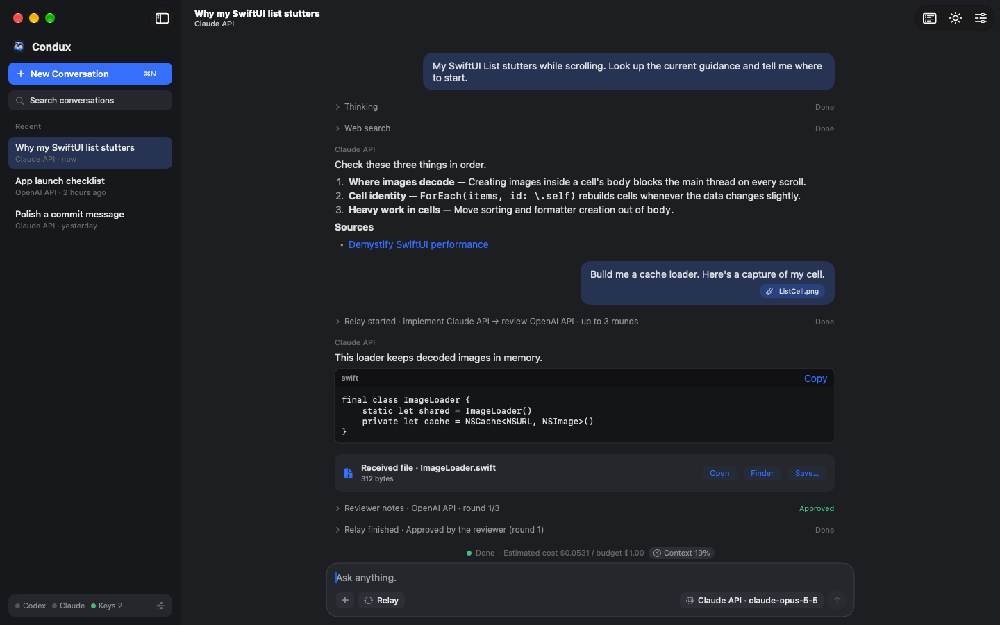

# Condux

[한국어](README.ko.md) · [Website](https://condux.co.kr) · [Guide](docs/guide-en.md)

**A Mac workspace for directing several AIs from one window.** Hand work to Claude, GPT, or Codex, have one review another, and approve what they do. Your keys and sign-ins stay on your Mac.



> **Status: early.** Condux is built by one person and changes quickly. See [What has been tested](#what-has-been-tested) before relying on a feature.

## What it does

- **Talk to several AIs:** Claude API, OpenAI API, your Claude subscription (through the official Claude Code CLI), and Codex.
- **Web search:** API conversations can search the web and read links, and they show their sources.
- **Automatic relay:** One AI builds and another reviews and sends back fixes, until the reviewer approves or the round limit is reached.
- **Work in project folders:** The AI edits files and runs builds. You approve each command, and file changes can be reverted.
- **GitHub:** Uses your existing GitHub CLI sign-in, so the AI can commit and open pull requests with your approval.
- **Control other apps:** Start a control conversation, or add the Chrome tool, and the AI can open apps and work in web pages.
- **MCP tools:** Presets for Figma, Mobbin, Xcode, and Chrome.
- **Files:** Attach PNG, JPEG, PDF, and ZIP files, and receive files back.
- **Visible usage:** Context, tokens, estimated API cost, and subscription limits.
- **Local AI (experimental):** A small MLX model on Apple Silicon. No API key needed.

## Install

You need macOS 14 or later on Apple Silicon.

[**Download the latest version**](https://github.com/pgup3017/condux-app/releases/latest), unzip it, and move `Condux.app` to Applications. It's signed with Developer ID and notarized by Apple. It doesn't update itself yet, so check the releases page for new versions.

### Build from source

You need Xcode.

```bash
git clone https://github.com/pgup3017/condux-app.git
cd condux-app
scripts/build-local.sh
```

The script builds the app, signs it for your Mac only, and opens it. If Xcode asks you to trust a package plugin, open `Condux.xcodeproj` once and choose **Trust & Enable**, then run the script again.

## Connect

Press the connection status at the bottom left to open **Connections**, then connect at least one of these:

| Connection | How |
| --- | --- |
| Claude API, OpenAI API | Add your API key. Set a spending limit on the provider's site. |
| Claude subscription | Install Claude Code, press **Copy Sign-in Command**, and run it in Terminal. |
| Codex | Install Codex and press **Sign In with Browser**. |
| GitHub | Install GitHub CLI, press **Copy Sign-in Command**, and run it in Terminal. |

## Control Chrome and other apps

- **Other apps:** Press **Connections ▸ Control other apps ▸ Start Control Conversation**, then ask, for example, "open example.com in Safari." This needs a Claude subscription sign-in, and macOS asks for permission the first time.
- **Chrome:** Under **Connections ▸ Tools (MCP) ▸ Add**, choose **chrome**. This runs [Chrome DevTools MCP](https://github.com/ChromeDevTools/chrome-devtools-mcp) through `npx`, so it needs Node. It opens a separate Chrome window and profile.

The App Store sandbox doesn't allow this, so these features exist only in this version.

## Security

- API keys stay in the macOS Keychain. They aren't written to files or logs.
- Condux never reads Claude, Codex, or GitHub sign-in tokens. You sign in with each tool's own flow in Terminal.
- Commands are never allowed automatically. Optional auto-approval covers only file edits inside the project folder.
- Condux has no server of its own. Messages go only to the AI service you choose.
- Subscription conversations never switch to a paid API on their own.

**Giving an AI control of your computer has real risks.** A web page or file can contain instructions meant to mislead it. Read each command before you approve it. See [SECURITY.md](SECURITY.md).

## What has been tested

| Area | Status |
| --- | --- |
| Unit tests | `swift test` runs without any account (live-service tests are skipped) |
| Claude CLI streaming, `gh`, and web tools | Run against the real services |
| Web search through the APIs | Tested with simulated responses from the official format |
| Chrome tool, control conversation, Xcode tool | Not yet confirmed end to end |
| Local AI generation | Not yet confirmed end to end |

## Build for development

```bash
swift test
```

The `ConduxStore` scheme builds the sandboxed App Store variant, which has only API connections.

## Terms and trademarks

You're responsible for following the terms of each service you connect. Condux runs the Claude Code and Codex command-line tools as published, and each person signs in with their own account. Plans are intended for ordinary individual use, so heavy automation can hit limits.

Condux is an independent project and isn't affiliated with or endorsed by Anthropic, OpenAI, or GitHub.

## License

Code: [Apache-2.0](LICENSE). The Condux name and app icon aren't covered by the license; please use your own for forks.
